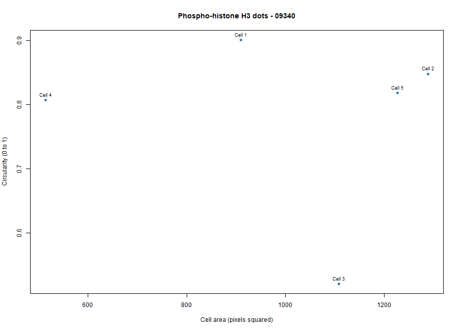
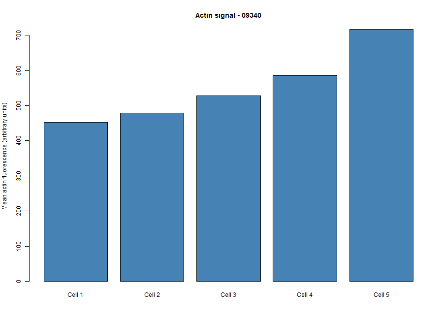

# Cytoskeleton and Cell Morphology — BBBC018

## Student Information
- **Student ID:** 202303480
- **Selected phenotype:** Phospho-histone H3 dots
- **Image-field ID:** 09340
- **Actin filename:** 09340-actin.DIB
- **DNA filename:** 09340-DNA.DIB

## Dataset
This activity used image set BBBC018v1 from the Broad Bioimage Benchmark Collection (Ljosa et al., *Nature Methods*, 2012).

Dataset page: https://bbbc.broadinstitute.org/BBBC018

Download link: https://data.broadinstitute.org/bbbc/BBBC018/BBBC018_v1_images.zip

The selected phenotype was classified by visually comparing the downloaded fluorescence images with the phenotype examples on the BBBC018 webpage. The phenotype is a visual classification and is not a verified annotation for the selected field.

## Methods: Highlighted Procedures
The figures below illustrate the key steps of this activity, from selecting the Phospho-histone H3 dots phenotype and image field 09340 from the BBBC018 dataset to measuring five cells in Fiji and analyzing the results in RStudio. 

**Figure 1. Selection of the Phospho-histone H3 dots phenotype from the BBBC018 dataset.** The example images show different cellular phenotypes of HT29 human colon-cancer cells. The Phospho-histone H3 dots phenotype was selected for this activity.

**Figure 2. Selection of image-field ID 09340 from the BBBC018 dataset.** The selected image field contains three corresponding fluorescence channels: 09340-actin.DIB, 09340-DNA.DIB, and 09340-pH3.DIB. 

**Figure 3. Opening the selected actin fluorescence image in Fiji.** The 09340-actin.DIB image from BBBC018 field 09340 was opened in Fiji to examine F-actin staining and identify cell outlines for morphology measurements.

**Figure 4. Setting the measurement parameters in Fiji.** The measurement settings were configured to record Area, Mean gray value, Shape descriptors, and Display label. The “Limit to threshold” option was left unchecked. 

**Figure 5. Opening the ROI Manager in Fiji.** The ROI Manager was opened to organize and manage the five selected regions of interest (ROIs) on the actin fluorescence image.

**Figure 6. Selection of five cells using the Freehand Selection tool in Fiji.** Five regions of interest (ROIs) were traced around selected cells in the actin fluorescence image. These regions were used to measure cell area, mean actin fluorescence intensity, circularity, and aspect ratio that is shown in the results table.

**Figure 9.  RStudio script and console output for analyzing results of the five measured selected cells from BBBC018 image field 09340.** The R script reads the measurement data collected from Fiji for the five selected cells in image field 09340. It summarizes cell area, circularity, aspect ratio, and mean actin fluorescence intensity, then generates two plots: cell area versus circularity and mean actin fluorescence intensity per cell. 

## Results

**Figure 10. Cell Area versus Circularity.** The five measured cells differed in area and circularity. Cell 2 had the largest area, while Cell 4 had the smallest. Cell 1 had the highest circularity, whereas Cell 3 had the lowest circularity, indicating a less round outline.

**Figure 11. Mean Actin Fluorescence Intensity.** Mean actin fluorescence varied among the five selected cells. Cell 5 had the highest mean intensity, while Cell 1 had the lowest. These values describe the selected regions in this image field and should not be treated as directly comparable with raw intensities from other fields.
